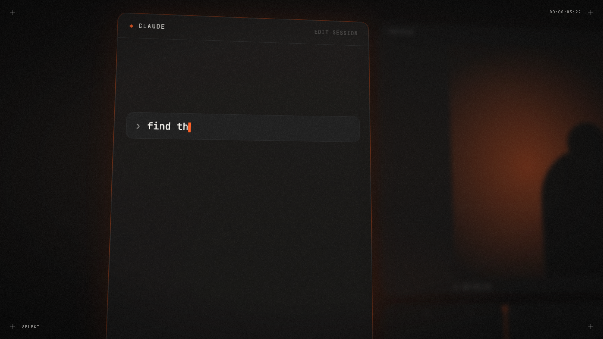
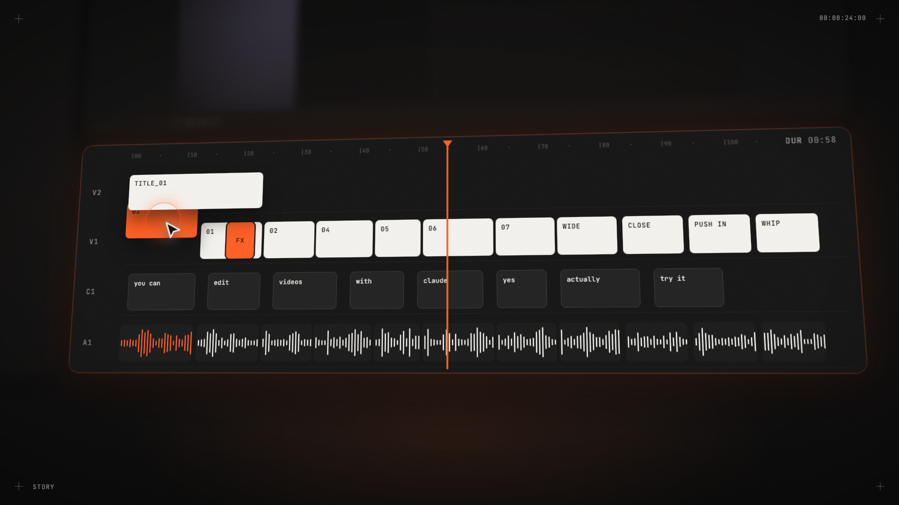
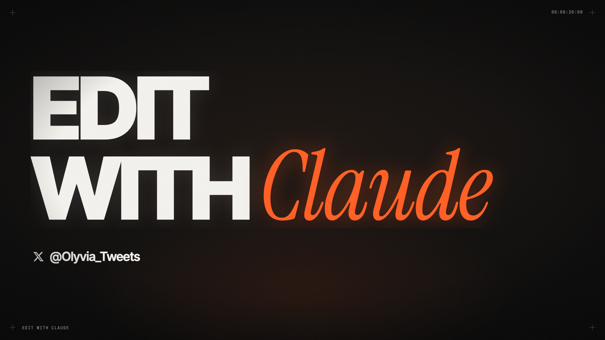

# Claude Edit Design (Opus 5.5)

A 30-second motion design piece for the **"Edit with Claude"** thread, about using Claude in a video editing workflow.

https://github.com/Olyvia075/claude-edit-design-opus-5.5/raw/main/video/edit-with-claude.mp4





## Concept
A Claude chat sits next to a video editor. Each prompt sets off a real edit on screen: picking the best clips, cutting dead air, storyboarding, captions, a custom glitch effect, a homemade title tool, and reordering the story. Big type moments (**CUT.**, **CAPTIONS**, **NO presets.**) punctuate the sequence.

**Style:** 3D-tilted floating interface, depth-of-field shifts between panels, a visible cursor, blur and ghost-trail transitions, a cycling intro word, dot-grid atmosphere, and a near-black / off-white / `#FF5B1F` palette.

## Built with
- [Remotion](https://www.remotion.dev/) (React): the whole video is code
- Inter Tight, Instrument Serif, JetBrains Mono

## Run it
```bash
npm install
npm run studio   # live preview
npx remotion render src/index.ts EditWithClaude out/video.mp4
```

| File | What |
|---|---|
| `src/EditorUI.tsx` | Chat, preview monitor, timeline, 3D camera, cursor |
| `src/Type.tsx` | Intro, type punches, end card, background, overlays |
| `src/Video.tsx` | Scene timing and transitions (1920×1080, 30fps, 900 frames) |

Made by [@Olyvia_Tweets](https://x.com/Olyvia_Tweets)
